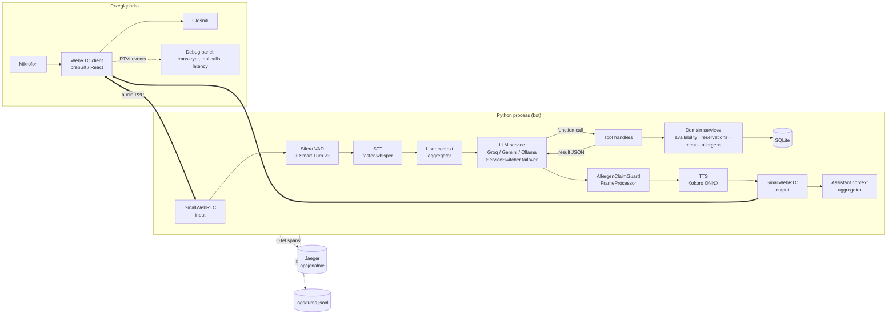
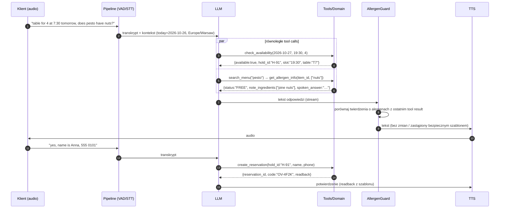

# 02 — Architektura

## Widok systemu



## Warstwy (dependency rule: strzałki tylko w dół)

```
channels/      voice_webrtc.py, text_cli.py           ← wejście/wyjście
pipeline/      bot.py, processors/, observers/        ← Pipecat: składanie pipeline
dialogue/      prompts, state, renderers (templates)  ← polityka rozmowy
tools/         schemas, handlers, registry            ← adapter LLM ↔ domena
domain/        availability, reservations, menu, allergens, clock  ← czysty Python, zero I/O frameworków
db/            schema.sql, repository, seed            ← SQLite
```

**Reguła:** `domain/` nie importuje Pipecata ani klienta LLM. Dzięki temu 80% logiki testuje się bez modeli, a ten sam kod obsługuje kanał głosowy, tekstowy i eval.

## Przepływ jednej tury (multi-intent)



## Kluczowe mechanizmy

### 1. Hold → confirm → commit (two-phase booking)
`check_availability` nie tylko odpowiada „jest/nie ma”, ale zakłada **hold** (soft-lock na 5 min) i zwraca `hold_id`. `create_reservation` przyjmuje wyłącznie `hold_id` — LLM fizycznie nie może zarezerwować terminu, którego nie sprawdził, ani „wymyślić” godziny. Hold wygasa → slot wraca do puli.

### 2. Readback renderowany deterministycznie
Daty, godziny, liczba osób i kod potwierdzenia wypowiadane klientowi pochodzą z pola `readback` w wyniku narzędzia (szablon w `dialogue/renderers.py`), nie z parafrazy LLM. Eliminuje klasę błędów „7:30 PM” vs „7:30 AM”.

### 3. AllergenClaimGuard (procesor między LLM a TTS)
Szczegóły w [06 — Dialog i guardrails](06-dialogue-guardrails.md). Zasada: każde zdanie zawierające twierdzenie o alergenie musi mieć pokrycie w wyniku `get_allergen_info` z bieżącej tury; inaczej zdanie jest zastępowane bezpiecznym szablonem + oferta handoffu. Możliwe tylko w architekturze kaskadowej ([ADR-0002](adr/0002-cascaded-pipeline.md)).

### 4. Failover providerów
LLM opakowany w `ServiceSwitcher` ze strategią failover (Groq → Gemini Flash → Ollama). Błędy permanentne (zły klucz) vs przejściowe (429/503) rozróżnia Pipecat (`is_usable`, `ErrorCategory`). Przełączenie logowane jako zdarzenie i liczone w raporcie.

### 5. Context management
- System prompt + definicje narzędzi stałe (prompt caching po stronie providera, jeśli dostępny).
- Historia przycinana do ostatnich N tur + strukturalny `ConversationState` (party_size, date, time, hold_id, name) wstrzykiwany jako krótki blok zamiast pełnej historii — ogranicza tokeny (limity TPD free tieru).

## Latency budget (cel, do zmierzenia)

| Etap | Budżet p50 | Uwagi |
|---|---|---|
| End-of-turn (VAD stop + Smart Turn) | 200–400 ms | VAD `stop_secs≈0.2` + Smart Turn < 100 ms na CPU |
| STT (faster-whisper, segmentowy, GPU) | 150–350 ms | segment po końcu tury, nie streaming |
| LLM TTFT (Groq) | 200–500 ms | zależy od modelu i obciążenia free tieru |
| Tool execution (SQLite) | < 20 ms | lokalnie |
| Drugi LLM call po tool result | 200–500 ms | dlatego równoległe tool calls mają znaczenie |
| TTS TTFB (Kokoro) | 100–300 ms | zdania streamowane od pierwszego |
| **Voice-to-voice** | **≤ 1.5 s p50** | mierzone przez `UserBotLatencyObserver` |

Mitigacje gdy budżet przekroczony: filler („Let me check that for you…”) wypowiadany natychmiast przy tool callu, krótszy system prompt, mniejszy model STT (`distil-*`), model LLM o niższym TTFT.

## Kanały

| Kanał | Transport | Użycie |
|---|---|---|
| `voice` | `SmallWebRTCTransport` + prebuilt UI / klient React | demo, testy manualne |
| `text` | pipeline bez STT/TTS (wejście: tekst jako ramki transkrypcji) | CLI, harness ewaluacyjny, CI |
| `eval-audio` | transport ewaluacyjny Pipecat Evals (`-t eval`) | testy audio end-to-end |

> [!IMPORTANT]
> Spike w M2: potwierdzić w Pipecat Context Hub najprostszy sposób uruchomienia tego samego pipeline'u w trybie tekstowym (np. wstrzykiwanie `TranscriptionFrame`, narzędzia testowe frameworka). Jeśli to niepraktyczne — fallback opisany w [ADR-0006](adr/0006-two-level-evaluation.md).
